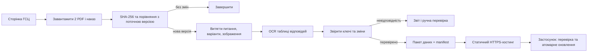

# Оновлення офіційних питань ПДР

Стан дослідження: 24.10.2026. Це проєкт конвеєра імпорту, а не запущена автоматизація.

## Першоджерело

Єдина точка входу для екзаменаційної бази — [сторінка ГСЦ МВС «Питання та іспит з ПДР»](https://hsc.gov.ua/index/poslugi/vidacha-posvidchennya-vodiya/pitannya-ta-ispit-z-pdr/). Вона посилається на [PDF питань](https://hsc.gov.ua/wp-content/uploads/2025/11/POLOTNO-NAKAZ_04_09_2025%20%281%29.pdf), [окремий PDF відповідей](https://hsc.gov.ua/wp-content/uploads/2025/11/Numer_-vidpovidej-do-nakazu.pdf) і накази, які затверджують зміни. На дату аналізу сторінка вказує наказ № 225 від 29.10.2025. [ГСЦ пояснює](https://hsc.gov.ua/2026/03/31/teoretichnij-ispit-yak-formuyutsya-ta-onovlyuyutsya-pitannya/), що питання оновлюють при змінах правил, законодавства або формулювань. Документованого публічного API для машинного отримання цієї бази на сторінці не знайдено.

Перевірка поточних файлів:

| Файл | Розмір | Сторінки | Висновок |
|---|---:|---:|---|
| PDF питань | 43 624 958 байтів | 539 | Текст виділяється програмно на всіх 539 сторінках; зображення мають окремі об'єкти й координати. Питання й варіанти можуть переходити через межу сторінки. |
| PDF відповідей | 2 086 168 байтів | 11 | На всіх 11 сторінках немає текстового шару; це скановані таблиці, для яких потрібен OCR або інше надійне машинне джерело. Ключ відповіді — **розділ + номер питання**, а не номер сам по собі. |

SHA-256 перевірених файлів: питання `1AA8CB2F95262D1D72A9EE63E82DAA68F7A23F75FB627F2C986CB5BC20FE0CBF`; відповіді `40D2DB5467AF027C3E806DB51BBA9517BE2E8487A8AD2D22A2BEBF8C3830CCC6`.

Назва PDF питань містить старішу дату, ніж номер наказу на сторінці. Не визначати актуальність лише з імені файлу: фіксувати номер наказу, URL, дату перевірки та SHA-256 вмісту.

## Рекомендований конвеєр



1. **Моніторинг.** Перевіряти офіційну сторінку раз на добу й після повідомлень ГСЦ про зміни. Витягувати саме посилання зі сторінки, а не тримати жорстко прописані імена файлів. Скачати обидва PDF і наказ, перевірити MIME-тип, розмір, відкриття PDF та SHA-256. Якщо джерело недоступне, залишити активну базу без змін і повідомити про збій. Під час цього дослідження прямий запит з PowerShell отримував `Access Denied`, тоді як завантаження через браузер працювало; середовище майбутнього виконавця треба перевірити окремо. Не обходити CAPTCHA чи захист сайту.
2. **Витяг питань.** Читати текст і геометрію сторінок PDF (`pdfplumber`/Poppler). Розпізнавати заголовки розділів, початки питань і маркери варіантів. Підтримувати питання та варіанти, розбиті між сторінками. Зображення прив'язувати до питання за координатами, а сумнівні прив'язки виносити на перевірку. Не припускати незмінну кількість варіантів.
3. **Витяг відповідей.** OCR сканованих таблиць із попередньою обробкою зображення. Зчитувати кожну пару рядків «Питання»/«Відповідь» у межах підписаного розділу. Зберігати координати клітинок і впевненість OCR для можливості звірки зі сканом. Зміни правильної відповіді завжди позначати для додаткової перевірки за офіційним документом.
4. **Звірка.** Усі ключі `section_id + question_number` мають бути унікальними. Кожне питання повинно мати рівно одну відповідь із допустимим номером варіанта; кожна відповідь повинна вказувати на наявне питання. Перевіряти порожній текст, пропущені варіанти/ілюстрації, різкий спад кількості питань, дублікати, пошкоджені зображення. Робити diff тексту, варіантів, зображень та ключів між версіями. За помилки чи неоднозначності публікацію зупиняти.
5. **Пакет.** Генерувати компактний версійний `questions.sqlite` або `questions.json` плюс оптимізовані ілюстрації. У `manifest.json` записувати `schemaVersion`, `datasetVersion`, наказ ГСЦ, URL джерел, SHA-256 джерел і пакета, кількість питань та URL пакета. Старий пакет лишається доступним для відкату. Сирі PDF не комітити в Git-історію.
6. **Публікація.** На старті можна роздавати статичний пакет через HTTPS разом із сайтом із гілки `site` (наприклад, `/data/manifest.json`), якщо це відповідає обсягу трафіку й призначенню GitHub Pages. Для більшого продукту — окреме сховище/CDN з тим самим форматом manifest. GitHub Pages має [обмеження на розмір і трафік](https://docs.github.com/en/pages/getting-started-with-github-pages/github-pages-limits). Публікувати спочатку пакет під новою незмінною URL, потім оновлювати manifest як останній крок. Це не торкається `master`.
7. **Оновлення Android.** Перший перевірений пакет постачається в APK. Під час запуску застосунок читає manifest через HTTPS, порівнює `datasetVersion` і `schemaVersion`, завантажує новий пакет у тимчасове місце, звіряє SHA-256 і структуру, а тоді атомарно перемикає активну базу. Якщо будь-який крок не пройшов — працює попередня база. Результати тестів зберігають ID питання **та версію набору**, щоб нове формулювання не змінювало історію спроб.

## Формат контракту

```json
{
  "schemaVersion": 1,
  "datasetVersion": "hsc-2025-10-29-225-r1",
  "sourceOrder": "225/2025-10-29",
  "questionCount": 0,
  "sourceSha256": { "questionsPdf": "...", "answersPdf": "..." },
  "pack": { "url": "data/hsc-2025-10-29-225-r1.zip", "sha256": "..." }
}
```

`questionCount: 0` тут лише приклад структури: фактичне значення генератор повинен обчислити й перевірити. Питання повинно мати `section_id`, `question_number`, стабільні ID варіантів, категорії, текст, опційне зображення та джерело. Правильну відповідь зберігати через ID варіанта, щоб порядок варіантів можна було перемішувати без помилки.

## Межа автономності та гілки

- Пошук змін, завантаження, витяг, звірка, звіт і формування кандидата можуть працювати автоматично. Публікація допускається лише після всіх перевірок; невпевнене OCR, змінений ключ відповіді, сумнівна ілюстрація чи великий неочікуваний diff зупиняють її. Це захищає користувачів від помилкового навчання.
- Код конвеєра розробляти й комітити в `dev` англійськими повідомленнями. У `site` — лише сайт і готові пакети даних, якщо оберемо Pages. `master` змінюється тільки за командою користувача про реліз APK.
- [Заплановані GitHub Actions виконуються з default branch](https://docs.github.com/en/actions/reference/workflows-and-actions/events-that-trigger-workflows), який зараз `master`. Тому workflow з `dev` сам по собі не почне працювати за розкладом до дозволеного релізу. Якщо генератор комітить пакет у `site` токеном `GITHUB_TOKEN`, [такий push не запускає автоматичну збірку Pages](https://docs.github.com/en/pages/getting-started-with-github-pages/configuring-a-publishing-source-for-your-github-pages-site); потрібне розгортання Pages в тому самому workflow або інший дозволений механізм.
- До публічного поширення бази та зображень окремо перевірити умови використання матеріалів. Брати джерела ГСЦ, не копіювати Green Way/Monolith.

## Найближчий практичний крок

Зробити локальний імпортер, що приймає **два PDF-файли** і видає JSON/SQLite-кандидат та звіт помилок. На перших кількох розділах звірити кожне питання, зображення й номер відповіді зі сканами. Локальні копії поточних PDF збережені в ігнорованій Git папці `sources/hsc-2025-10-29-225/` для такого прототипу. Лише після перевірки імпортера додавати планувальник і дистанційну публікацію.
